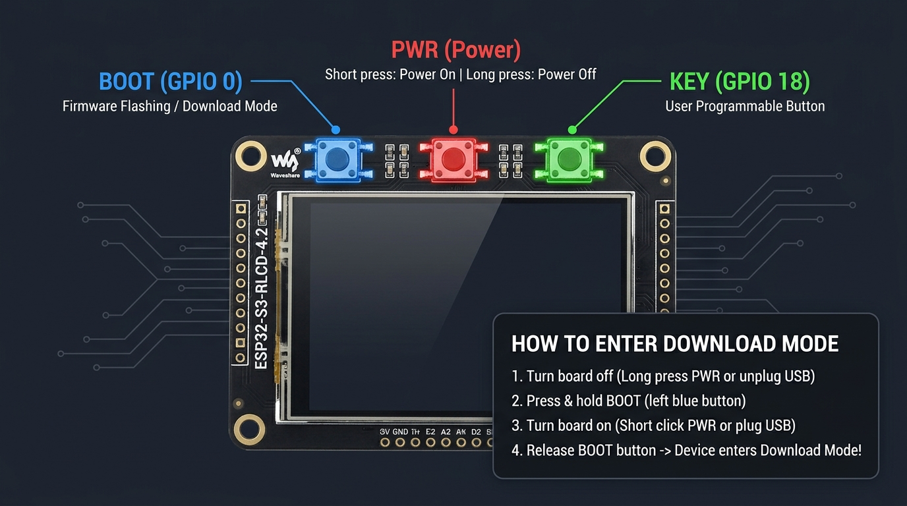
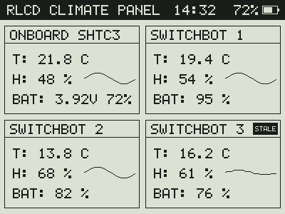
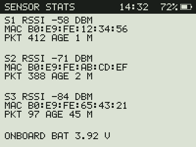
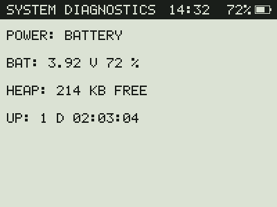
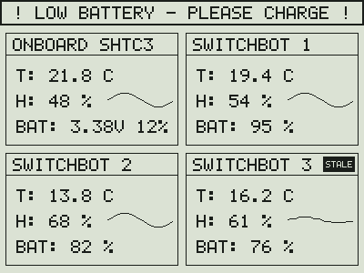

# rlcd-panel

Standalone `Arduino CLI` (`ESP32-S3`) firmware for the **Waveshare ESP32-S3-RLCD-4.2** reflective LCD panel (`B0GF23YC3Y`) that directly receives BLE advertisements from up to three **SwitchBot IP65 Indoor/Outdoor Thermo-Hygrometers** (`WoIOSensor`, `B0DXPHZMMP`) and reads the onboard `SHTC3` climate sensor.

## Target Hardware

| Component | Model / ASIN | Details |
| :--- | :--- | :--- |
| **Display & MCU Board** | Waveshare `ESP32-S3-RLCD-4.2` (`B0GF23YC3Y`) | `ESP32-S3-WROOM-1-N16R8` (16 MB Flash, 8 MB Octal PSRAM), 4.2" `ST7305` RLCD (400×300, 1-bpp monochrome, no backlight), onboard `SHTC3`, `PCF85063A` RTC, `ES8311` + `ES7210` audio, `MicroSD`, 18650 charger |
| **External BLE Sensors (3×)** | SwitchBot IP65 Indoor/Outdoor Thermo-Hygrometer (`WoIOSensor`, `B0DXPHZMMP`) | Unencrypted BLE advertisements (`Company ID 0x0969` Manufacturer Data + `UUID 0xFD3D` Service Data) |

## Internal Onboard GPIO Mapping (`ESP32-S3-RLCD-4.2`)

| Bus / Peripheral | Chip | Signal | GPIO | Notes |
| :--- | :--- | :--- | :--- | :--- |
| **RLCD Display (SPI)** | `ST7305` | `SCK` / `MOSI` / `CS` / `DC` / `RST` / `TE` | `GPIO11` / `GPIO12` / `GPIO40` / `GPIO5` / `GPIO41` / `GPIO6` | 400×300 monochrome (15,000-byte framebuffer, 2×4 block byte packing) |
| **Shared I²C Bus** | `SHTC3` (`0x70`), `PCF85063A` (`0x51`), `ES8311` (`0x18`), `ES7210` (`0x40`) | `SDA` / `SCL` | `GPIO13` / `GPIO14` | Shared internal and rear-header I²C bus |
| **MicroSD Card** | `SD_MMC` (1-bit mode) | `CLK` / `CMD` / `D0` | `GPIO38` / `GPIO21` / `GPIO39` | Call `SD_MMC.setPins(38, 21, 39)` before `SD_MMC.begin("/sdcard", true)` |
| **Audio I²S** | `ES8311` / `ES7210` | `DOUT` / `BCLK` / `DIN` / `MCLK` / `LRCLK` / `PA_CTRL` | `GPIO8` / `GPIO9` / `GPIO10` / `GPIO16` / `GPIO45` / `GPIO46` | Speaker DAC and dual-microphone array |
| **Buttons & Battery** | Onboard | `BOOT` / `KEY` / `BAT_ADC` | `GPIO0` / `GPIO18` / `GPIO4` | Buttons active-low; battery voltage divider `3.0×` (monitored in header bar and onboard tile) |

## Hardware Buttons & Download Mode

The Waveshare `ESP32-S3-RLCD-4.2` has three physical push buttons arranged in a row along the **top edge** of the board:



| Position (Top Edge, L → R) | Button | Mapping | Function |
| :--- | :--- | :--- | :--- |
| **1. Links (Left)** | `BOOT` | `GPIO0` (Active Low) | ROM Bootloader / Download Mode |
| **2. Mitte (Middle)** | `PWR` | Power-Management | **Klick:** Einschalten / Wake<br>**Gedrückt halten (> 5 s):** Ausschalten |
| **3. Rechts (Right)** | `KEY` | `GPIO18` (Active Low) | Frei programmierbare Benutzertaste |

### Manuell in den Download Mode (Flash-Modus) versetzen

Wenn der `esptool`-Upload den Fehler `Wrong boot mode detected` meldet:

1. **Board ausschalten:** Entweder `PWR` (mittlere Taste) lange gedrückt halten oder das USB-Kabel abziehen.
2. **`BOOT`-Taste (linke Taste) gedrückt halten.**
3. **Board einschalten:** Entweder kurz auf `PWR` (mittlere Taste) klicken oder das USB-Kabel einstecken.
4. **`BOOT`-Taste loslassen.**

Der ESP32-S3 befindet sich nun im ROM Download Mode (`0x0`) und akzeptiert Flash-Vorgänge über `esptool` / `arduino-cli`.

## Rear 2×8 Expansion Header Layout

### Left Header Side (Pins 1–8, Row 1)

| Pin | Label | ESP32-S3 Function |
| :--- | :--- | :--- |
| **1** | `VBUS` | 5 V USB Supply |
| **2** | `GND` | Ground |
| **3** | `GPIO19` | `USB_D-` |
| **4** | `GPIO20` | `USB_D+` |
| **5** | `GPIO43` | `U0TXD` |
| **6** | `GPIO44` | `U0RXD` |
| **7** | `GPIO13` | `I2C_SDA` |
| **8** | `GPIO14` | `I2C_SCL` |

### Right Header Side (Pins 1–8, Row 2)

| Pin | Label | ESP32-S3 Function |
| :--- | :--- | :--- |
| **1** | `3V3` | 3.3 V Regulated Supply |
| **2** | `GND` | Ground |
| **3** | `GPIO0` | `BOOT` (Strapping Pin, Active Low) |
| **4** | `GPIO1` | Free GPIO / `ADC1_CH0` |
| **5** | `GPIO2` | Free GPIO / `ADC1_CH1` |
| **6** | `GPIO3` | Free GPIO / `ADC1_CH2` |
| **7** | `GPIO17` | Free GPIO |
| **8** | `GPIO18` | `KEY` Button (Active Low) |

## Display Views

The panel renders three views. The `KEY` button on `GPIO18` (active low, internal pull-up) cycles them in this fixed order: **Dashboard → Sensor Stats → System Diagnostics → Dashboard**. The source of truth is `DisplayMode` in `rlcd_panel/button_handler.h`, the pin is `PIN_BTN_KEY` in `rlcd_panel/board_pins.h`. All images below are bit-exact renderings from `./scripts/generate-display-preview.sh` with fixed sample data.

### Mode 0: Dashboard



Four climate tiles: the onboard `SHTC3` and up to three SwitchBot sensors. Each tile shows temperature, humidity, battery, and a 24-hour temperature sparkline. A `STALE` badge marks a SwitchBot sensor without a recent packet. The header shows the title, the clock, and the battery level of the panel. This is the default view after a power-on.

### Mode 1: Sensor Stats



One text block per SwitchBot sensor with `RSSI`, `MAC` address, received packet count (`PKT`), and the age of the last packet (`AGE`). The last line shows the onboard battery voltage.

### Mode 2: System Diagnostics



Power source (battery or USB), battery voltage and percentage, free heap, and uptime.

### Low Battery Alert



If the battery is low, an inverted warning banner replaces the header bar in every view. The preview shows the banner on the dashboard. The alert uses hysteresis, so it does not flicker around the threshold.

### Switching Views with the `KEY` Button

1. Press `KEY` (`GPIO18`) once. A debounced press (30 ms) moves to the next view.
2. After a `KEY` wakeup or a power-on, the board stays awake for 3 s. Each further press in this window redraws the next view without a new wakeup.
3. A press while the board sleeps wakes it through `ext0` on `GPIO18`. This press also moves to the next view.
4. The selected view stays in RTC memory across deep sleep, so the timer wakeups redraw the same view.

To render a single view by hand, run `render_display_preview <out.bmp> [mode 0..2] [low]` (source: `tools/render_display_preview.cpp`). The scene list for all previews is `PREVIEW_SCENES` in `tools/preview_scenes.h`.

## Power Management

The firmware sleeps between measurements. Each 60 s cycle scans BLE for 4 s, redraws the display, and enters deep sleep. The reflective LCD keeps the image without power. RTC memory keeps the sensor registry, battery reading, and view mode. Press `KEY` to wake the board and cycle the view. The serial port is not active during deep sleep, so hold `BOOT` while you connect `PWR` or USB to flash (see above).

## Build, Test, Preview, and Flash Commands

### 1. Generate Display Preview Image

```bash
./scripts/generate-display-preview.sh
```
Renders bit-exact 400×300 previews of the monochrome RLCD screen into `docs/`: `display_preview_dashboard.png` (also `display_preview.png`), `display_preview_stats.png`, `display_preview_diagnostics.png`, and `display_preview_low_battery.png`.

### 2. Run Host Unit Tests

```bash
c++ -std=c++17 -Wall -Wextra -Werror tests/test_firmware_logic.cpp -o test_runner && ./test_runner && rm -f test_runner
```

### 3. Compile Firmware with `arduino-cli`

```bash
arduino-cli compile rlcd_panel
```

### 4. Back Up Current / Factory Flash Before Flashing

```bash
./scripts/backup-firmware.sh
```

### 5. Flash Firmware to Board (with Pre-Flash Preview)

```bash
./scripts/flash-firmware.sh
```
